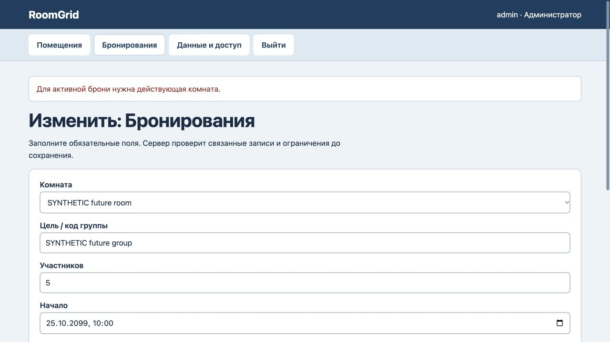
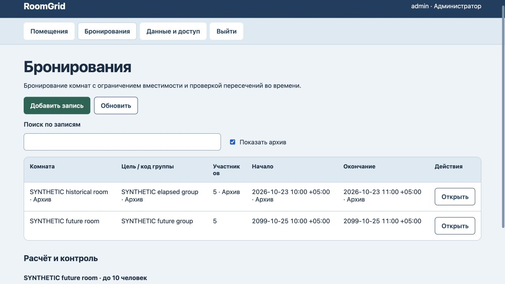

# RoomGrid: архив прошедшей брони

25 октября 2026. Прошедший интервал со статусом booked нельзя было архивировать без фиктивной отмены. Регрессия сначала завершилась ошибкой. Теперь существующую прошедшую бронь и её помещение можно архивировать, сохраняя статус, ссылку и время. Будущая/идущая бронь и помещение защищены; новая бронь архивной комнаты запрещена даже задним числом. Проверены точная граница окончания, перезапуск и восстановление. Браузерный отказ архивирования будущего интервала сохранил полный payload/версию4/журнал4. Прошедшая бронь и комната архивированы, статус booked и время10:00–11:00+05 сохранены, будущая бронь не изменена, версия6/журнал6; история прочитана через Показать архив. Прошедший интервал не доказывает проведение встречи.

Все 5 тестов прошли. [Машинная проверка](history-verification.json).

Сервер проверен локально. Новые внешние интеграции, клиентская приёмка и промышленное размещение не заявлены. Разметка и схема данных не менялись; новый полный аудит интерфейса или безопасности не проводился.
